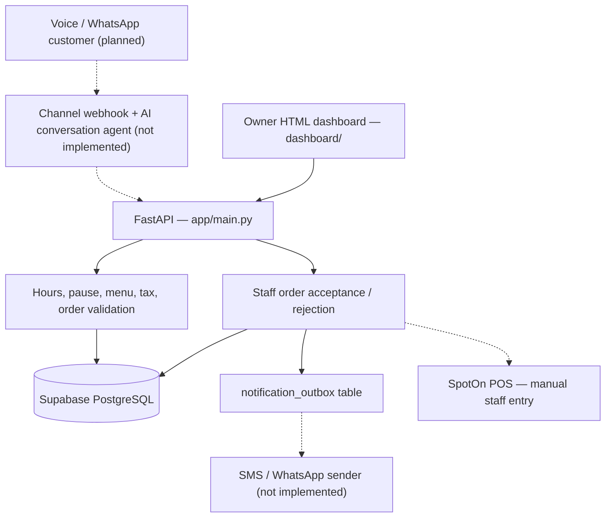
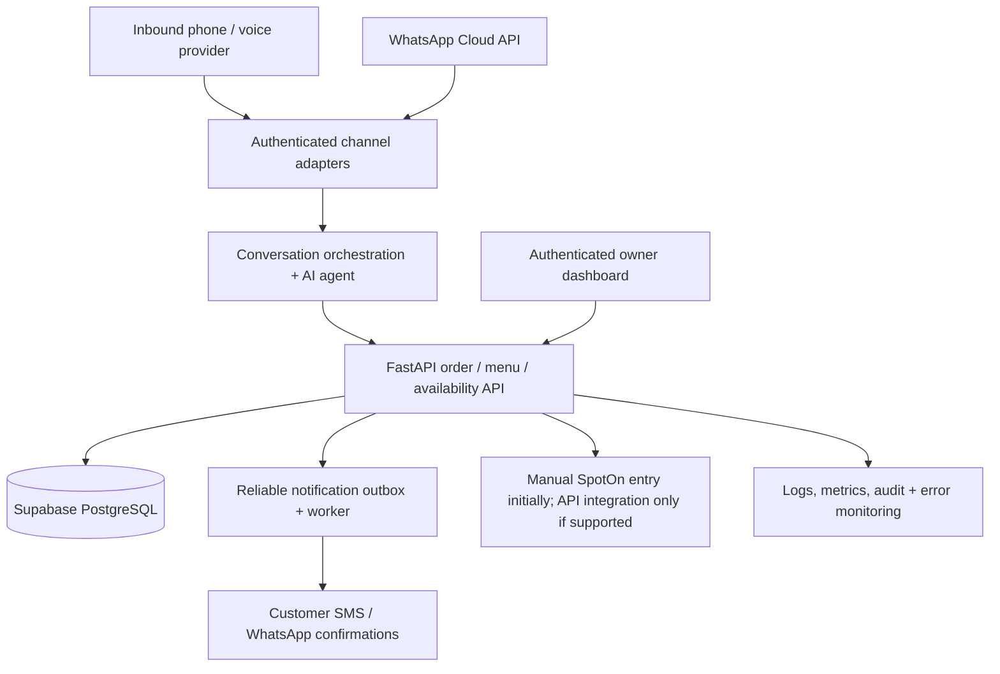

# Chicha's AI Ordering — Local FastAPI POC

## Project layout
- `app/main.py`: FastAPI endpoints (menu, restaurant policy, orders, owner menu availability)
- `dashboard/index.html`: local owner menu page
- `supabase/migrations/`: migrations already applied to Chicha's Supabase project
- `supabase/seed_menu_draft.sql`: draft menu import (162 records)
- `tests/`: backend tests

## Local setup
```bash
cd ~/Projects/chichas-ai-ordering
source .venv/bin/activate
cp .env.example .env
# Edit .env on your Mac with the Supabase connection URI and a random staff key
uvicorn app.main:app --reload --host 127.0.0.1 --port 8000
```

Open `http://127.0.0.1:8000/docs` for API documentation or `http://127.0.0.1:8000/owner/menu` for the owner page.

**Safety:** The owner page is a local POC and uses a shared staff key, not production authentication. Do not expose it to the public Internet. Live ordering remains disabled until menu and tax are approved.

## Architecture (current implementation)

The backend is a **local proof of concept**, not a deployed voice/WhatsApp ordering service. Solid arrows below represent code paths implemented in this repository. Dashed arrows represent planned integrations or manual steps.



### Implemented components

- **FastAPI** (`app/main.py`): health, restaurant availability, menu listing, order creation, owner pause, menu availability updates, staff order listing, test orders, and accept/reject endpoints.
- **Order validation**: checks live-order enablement, menu and tax approval, opening hours and cutoff, owner pause, item availability, spice eligibility, customer confirmation, and an idempotency key. Calculates totals from database prices.
- **Staff controls**: shared `X-Staff-Api-Key` header for POC-only staff endpoints. Accepting an order requires staff confirmation that it was manually entered into SpotOn; a generated reference is **not** a pickup confirmation until accepted.
- **Supabase PostgreSQL** (`supabase/migrations/`): restaurant/menu, customers, conversations/carts, orders/items/events, notification outbox, and audit-related schema. Some tables support future integrations but are not wired into live channel handlers.
- **Owner pages**: `dashboard/index.html` and `dashboard/orders.html`, served at `/owner/menu` and `/owner/orders`.
- **Draft menu**: `supabase/seed_menu_draft.sql`; review and approve menu/tax before enabling live orders. Do not rerun seeds blindly.

### Target architecture (planned)



**Not yet implemented:** inbound voice and WhatsApp webhooks, AI agent/orchestrator, outbound message worker, production staff login, hosting/monitoring, and automated SpotOn integration. The current backend writes notification-outbox events for qualifying accepted/rejected non-test orders, but does not send messages. Keep customer messaging subject to consent and channel policies.

**Security:** Never commit `.env`, tokens, API keys, or database credentials. Replace the shared staff key with authenticated staff accounts before exposing the service publicly.

## Tests
```bash
pytest -q
```

## Supabase
Project ref: `lretkjtccfwtrulqohmc` (US East). Migrations and draft menu were already applied remotely. Do not rerun the seed without reviewing it.
