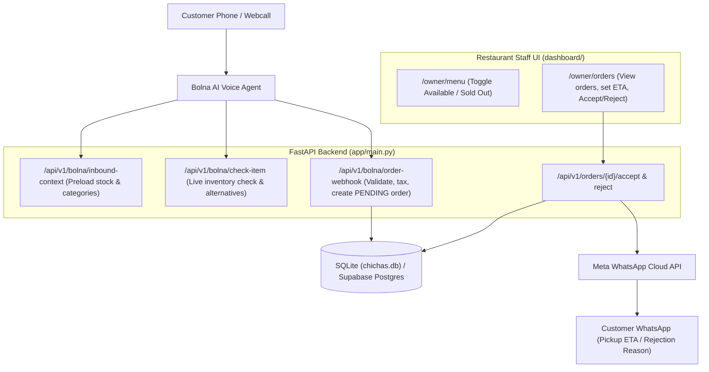

# Chicha's AI Ordering — Voice & WhatsApp System

Production-ready Proof of Concept for **Chicha's Indian Restaurant**:
1. **Inbound Voice AI (Bolna):** Live menu stock checking, voice order taking, and cart confirmation.
2. **Hotel Staff Dashboard:** Web UI for restaurant staff to review incoming orders, mark items out of stock, set pickup ETAs, and Accept or Reject orders.
3. **Automated WhatsApp Notifications:** Instant customer messaging via Meta WhatsApp Cloud API with pickup time windows upon acceptance or cancellation reasons upon rejection.

---

## Architecture



---

## Implemented Workflows & Components

### 1. Bolna AI Voice Endpoints
* **`GET /api/v1/bolna/inbound-context`**: Preloads speech-friendly menu categories, open/closed status, and currently sold-out items (`{{out_of_stock}}`).
* **`GET & POST /api/v1/bolna/check-item`**: Live in-call inventory check. If an item is sold out, automatically returns up to 2 available alternatives from the same category.
* **`POST /api/v1/bolna/order-webhook`**: Validates ordered items live against menu stock, calculates tax and totals, supports both flat and nested schemas (strictly compliant with Azure OpenAI `gpt-4.1-mini`), and creates the order in `PENDING_APPROVAL` status.

### 2. Hotel Staff Dashboard
* **`/owner/orders` (`dashboard/orders.html`)**: Real-time incoming order dashboard. Staff reviews customer details and line items, inputs pickup ETA minutes (e.g. 25 min), and clicks **Accept** (confirming SpotOn entry) or **Reject**.
* **`/owner/menu` (`dashboard/index.html`)**: Allows staff to search any of the 162 menu items and toggle their availability between `AVAILABLE` and `SOLD_OUT` in real time.

### 3. Automated WhatsApp Dispatch
* **Order Acceptance**: Calculates exact pickup window (e.g., *"Ready in approximately 25 minutes (around 7:45 PM EST)"*) and dispatches an automated WhatsApp confirmation message to the customer via Meta Graph API.
* **Order Rejection**: Dispatches an apology message to the customer with the staff's rejection reason.

### 4. Database
* **Local SQLite (`chichas.db`)**: Pre-seeded with 162 menu items across 19 categories.
* **`init_local_db.py`**: Standalone seeding script that initializes all tables and loads menu catalog directly from `supabase/seed_menu_draft.sql`.
* **PostgreSQL / Supabase Ready**: All queries are cross-dialect compatible with SQLite and Supabase PostgreSQL.

---

## Local Setup

### 1. Requirements
Ensure Python 3.10+ is installed. Install dependencies:
```bash
pip install -r requirements.txt
```

### 2. Initialize Database
Initialize the local SQLite database with the full menu:
```bash
python init_local_db.py
```

### 3. Environment Configuration
Copy `.env.example` to `.env`:
```bash
cp .env.example .env
```
Configure your credentials in `.env`:
```ini
DATABASE_URL=sqlite:///chichas.db
STAFF_API_KEY=chichas-staff-secret-2026
BOLNA_AUTH_TOKEN=chichas-bolna-secret-2026
BYPASS_HOURS=true

# Meta WhatsApp Cloud API (Optional for local testing, required for live WhatsApp dispatch)
META_ACCESS_TOKEN=your_meta_system_user_token
META_PHONE_NUMBER_ID=your_meta_phone_number_id
GRAPH_API_VERSION=v21.0
```

### 4. Run Server
Start the FastAPI server:
```bash
uvicorn app.main:app --host 127.0.0.1 --port 8000 --reload
```

* **Swagger Docs:** `http://127.0.0.1:8000/docs`
* **Staff Orders Dashboard:** `http://127.0.0.1:8000/owner/orders`
* **Staff Menu Availability:** `http://127.0.0.1:8000/owner/menu`

---

## Automated Tests

Run the complete test suite (all 9 unit tests):
```bash
pytest -q
```
Covers:
* Inbound context & category preloading
* Live stock checks and out-of-stock alternative recommendations
* Order webhook schema validation & order creation
* Staff menu availability toggle
* Staff order acceptance with pickup ETA calculation
* SpotOn entry verification logic
